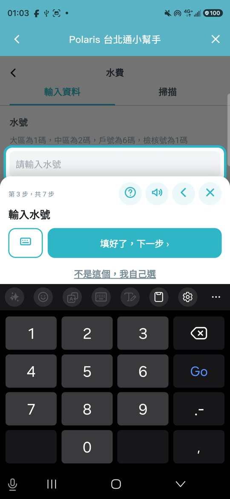
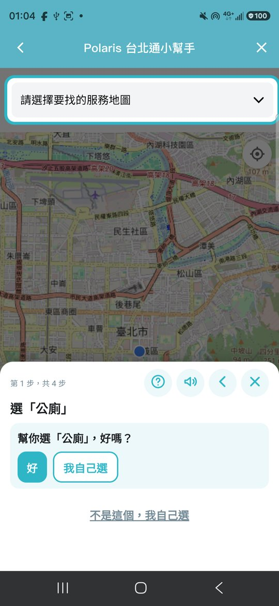
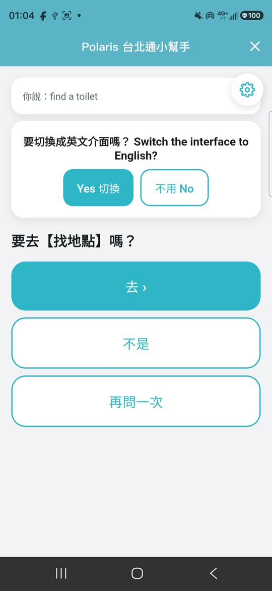
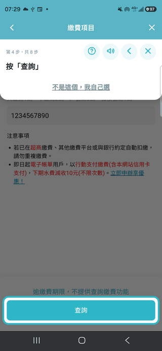
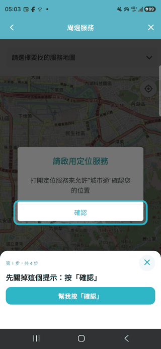
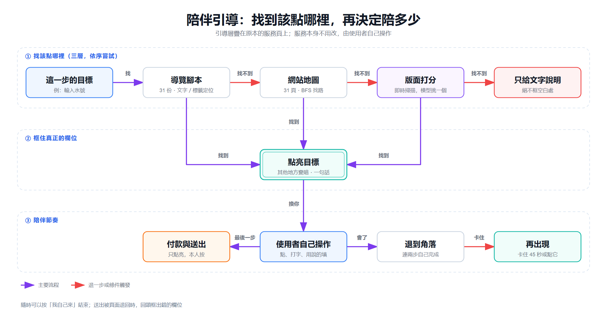
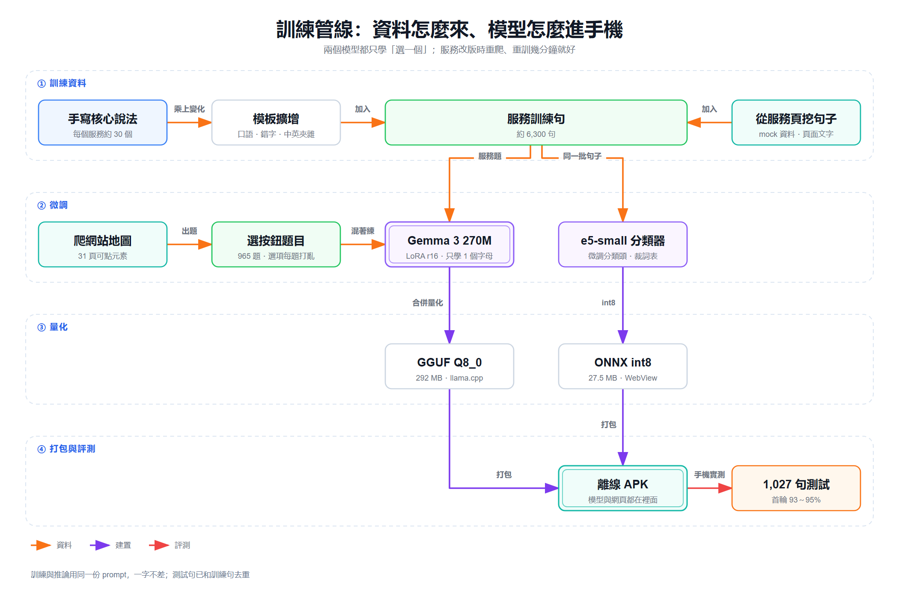

# PopPal — Polaris 城市通小幫手

> 說一句話，找到對的市政服務；再框住真正的欄位，陪你一步一步做完。
> 語音、翻譯、決策模型、服務網頁全部在手機上執行，飛航模式也能用。

臺北通 TownPass 2026 黑客松作品 · 程式碼：<https://github.com/taipei-doit/townpass2026-PopPal> · 安裝檔與模型權重：本 repo 的 **Releases**

---

## 一、一般參賽者必填項目

### 1. 專案簡介 / Project Overview

#### 專案目的與想解決的問題

城市通有幾十項服務。對長輩、小朋友、數位能力較弱或中文不熟的市民來說，難的是「找不到該按哪裡」和「到了頁面也不會填」：

- **不知道服務在哪裡**：要繳水費、陳情、找廁所，得先知道它藏在哪個分類、叫什麼名字。
- **到了頁面也不會操作**：欄位、分頁、彈出視窗、原生選單，一步卡住就放棄。
- **雲端 AI 不適合政府服務**：要連網、要把個資送出去，而且可能「一本正經地亂講」。

Polaris 的做法是在原本的城市通上**疊一層陪伴**，不改寫任何服務：

1. 按一顆鈕，用說的或打字說出想做的事；
2. 手機本地的小模型**只從服務清單裡挑一個**（不生成文字，不會編出不存在的服務），不確定就用按鈕追問；
3. 帶到服務頁後，**框住真正要點、要填的地方**並用一句話說明，使用者自己操作；會了就退到角落，卡住再出現；付款與送出一律由本人確認。

#### 核心功能摘要

- 一句話（中文、英文、越／印／泰語皆可）找到 37 項服務與功能之一，手機 NPU 上約 60 ms 判斷；不確定就追問、找不到就轉 1999。
- 陪伴引導疊在原服務頁上：點亮該操作的欄位、用說的填欄位；31 份導覽腳本，其中 15 條流程已在真機上從頭走到完成。
- 小朋友／一般／長輩三種介面；網頁、模型、語音翻譯全部打包進 APK，完全離線。

#### Demo 截圖

| 小幫手入口 | 說一句話 | 陪你繳水費 | 會了就退開 |
|---|---|---|---|
|  |  |  |  |
| **找廁所：幫你選公廁** | **找廁所：看標記** | **長輩模式** | **英文輸入** |
|  |  |  |  |
| **分齡介面** | **找不到：再問一次** | **亂點五下：我來了** | **隱藏儀表板** |
|  |  |  |  |

#### Demo GIF（真機逐步錄製，每個動作一格）

| 繳水費 | 找廁所 | 繳停車費（長輩模式） | 有話要說（陳情） |
|---|---|---|---|
|  |  |  |  |
| 框住水號欄 → 查詢 → 全部繳清 → 選信用卡 → 繳費完成 | 自動選好「公廁」→ 地圖出現標記 | 每一步唸出來；付款前先框住「是」再問一次 | 選類別 → 地點、主旨、描述逐欄陪填 → 案件受理 |

15 條流程、188 張真機逐步截圖在 Release 附件 `walkthrough-screenshots.zip`。

---

### 2. 系統架構 / System Architecture

#### 架構圖


整個系統分四層，全部跑在手機上：

1. **輸入**：TownPass App（Flutter）負責語音辨識，網頁本身只處理文字。
2. **決策**：小幫手（Vue 3，WebView 內）把一句話交給決策器，拿回每個工具代號的機率，再用工具表與固定規則決定下一步。
3. **本地模型與原生引擎**：llama-server 在 App 程序內執行 Gemma 決策器，優先用 Hexagon NPU；ML Kit 負責語言判斷與翻譯，flutter_tts 負責朗讀。
4. **執行與陪伴**：工具表定義每個工具要開哪一頁、帶哪些參數；陪伴引導層由 App 注入到每個服務頁，服務程式一行都不用改。

圖的原始檔與重新產生的方式見 [docs/diagrams/](docs/diagrams/)。

#### 決策流程：只做選擇題


- **只算 1 個 token**：prompt 前段是固定的工具清單（每個工具一個字母代號），最後接上使用者的話。llama-server 用 `max_tokens=1` 回傳候選字母的 logprob，換算成機率分布。模型不產生文字，所以不可能編出清單以外的服務。
- **固定前綴快取**：工具清單每次都一樣，KV cache 算一次就能重複使用，之後每句話只要處理十幾個 token。
  在 Galaxy S26 Ultra 上，前綴沒有快取時 NPU 要 94 ms、CPU 要 318 ms；有快取時兩者都在 20 ms 以內。端到端判斷約 63 ms（p50）。
- **第二意見**：Gemma 說「找不到」，但句子裡有明確的服務詞（例如「我想看漫畫」裡的「漫畫」）時，改請 e5 分類器再判斷一次。e5 的答案在相符的服務裡、而且機率 ≥ 0.8，才顯示確認卡。
- **查表融合**：工具表收錄 763 個項目名稱與別名（公廁、復康巴士、toilet……）。講到具體項目，就把對應工具的機率拉高；如果一個詞對應好幾個工具，只拉高這幾個，讓系統改成追問。
- **決策規則**：第一名 ≥ 0.75 就直接去，但仍先顯示「要去【X】嗎？」確認卡；前 2～3 名加總 ≥ 0.75 就用按鈕追問；其他情況顯示找不到，並提供「看全部服務」與「撥 1999」。
  使用者按「不是」時，只把該選項的機率歸零重排，不必重跑模型；最多追問兩輪。
- **參數只抽不猜**：水號、車牌、找地點的項目等參數只從原句抽取。抽到的值帶進服務頁後，由使用者確認，系統不自己補值。

#### 陪伴引導：框住真正的欄位，讓使用者自己做



- **疊在原服務上**：App 只注入一支載入器，由它載入 `guide-overlay.js`；被引導的服務頁維持原本的程式。
- **三層找目標**：
  1. 先用導覽腳本（31 份），以畫面文字、標籤、角色定位。
  2. 找不到就查爬出來的網站地圖（31 頁），用 BFS 找出「先點哪裡才會到那一頁」。
  3. 再找不到就即時掃描這一頁的可點元素並打分，有模型時讓 Gemma 從候選裡挑一個。
  4. 都找不到時只給文字說明，**絕不框空白處**。
- **怎麼陪**：
  - 框住真正的欄位或按鈕，其他地方變暗，並用一句話說明這一步。
  - 欄位可以用說的填，例如「水號是 1234567890」，系統用規則抽出數字後填入。
  - 遇到彈出視窗時，面板會自動縮小讓開。
  - 送出後被頁面退回，就回頭框出錯的欄位。
- **陪多少**：
  - 使用者連續兩步都自己完成，面板就縮成角落的小圓鈕；卡住 45 秒或點小圓鈕，它就回來。
  - 沒有在導覽時，如果 6 秒內亂點 5 下，小幫手會主動出現，問要不要幫忙。
  - 付款與送出只點亮、不代按。
  - 隨時可以按「我自己來」結束引導。
- **分齡**：
  - 長輩模式：字放大，每一步唸出來，送出前多問一次。
  - 小朋友模式：用簡單口語，付款前請大人一起看過。

#### 訓練管線：兩個小模型都只學「選一個」



- **訓練資料**：約 6,300 句服務語句，來源有三種：
  - 手寫的核心說法，再用模板乘上口語、語音辨識錯字、中英夾雜、外語等變化。
  - 從服務頁本身的 mock 資料與頁面文字自動挖出的句子。
  - 另有 965 題「選按鈕」題目，由爬好的網站地圖產生，每一題的選項順序都打亂，讓模型學會讀標籤，而不是背位置。
- **Gemma 3 270M**：凍結底座，只訓練 LoRA（rank 16，掛在 attention 與 MLP 的全部投影層）。loss 只計算最後一個位置，也就是答案字母。訓練與推論用同一份 prompt，程式會核對兩者一字不差。合併後量化成 GGUF Q8_0（292 MB）。
- **e5-small 分類器**：用同一批句子微調分類頭，詞表從 25 萬個 token 裁到約 1.3 萬，量化成 ONNX int8（27.5 MB），在 WebView 內用 Transformers.js 執行。
- **未微調的模型不能用**：在早期的 107 句測試集上，零樣本的 Gemma 270M／1B 第一輪只有 0～6%；在 1,027 句測試集上，零樣本 e5 約 50%。微調後兩者第一輪都超過 93%，詳見功能說明的準確度表。

#### 使用到的主要技術堆疊（Tech Stack）

| 類別 | 使用技術 / 版本 | 備註 |
|---|---|---|
| 前端框架 | Vue 3.4 + Vite 5 + TypeScript 5.4；服務頁另用 Tailwind CSS 3.4、Pinia、Leaflet 1.9 | `assistant/`（小幫手與陪伴引導層）、`TownPass-Services/`（服務頁） |
| App | Flutter 3.47.6（FVM）、flutter_inappwebview 6.1 | 以 TownPass 開源 App 為基礎；WebView 載入 APK 內建網頁 |
| 後端框架 | 無傳統後端；手機上的 llama.cpp b12180 `llama-server`（Snapdragon / Hexagon NPU 版） | 在 App 程序內以 JNI 啟動，只提供本機推論，不對外連線 |
| 資料庫 | 無；設定與紀錄存在 WebView 的 localStorage / sessionStorage，服務資料為 JSON | 沒有任何使用者資料離開手機 |
| AI 模型 | Gemma 3 270M（Google）LoRA 微調 → GGUF Q8_0；multilingual-e5-small（Microsoft）微調 → ONNX int8 | 訓練：PyTorch + Transformers + PEFT（`tools/llm`、`tools/encoder`） |
| 裝置端能力 | Android 語音辨識（speech_to_text 7.5）、Google ML Kit Language ID / Translation、flutter_tts | 語音、翻譯、朗讀都用手機本身的引擎 |
| 外部 API | 執行時不呼叫任何 API；地圖底圖使用 OpenStreetMap 圖磚（需要網路才顯示底圖） | 公廁、停車場為政府開放資料（見功能說明） |

---

### 3. 安裝與執行方式 / Installation & Run

#### 方式 A：直接安裝（最快）

1. 到本 repo 的 **Releases** 下載 `PopPal-Polaris-offline.apk`。
2. 在 Android 手機上安裝（需允許「安裝不明來源的應用程式」）。
3. 打開 TownPass → 首頁或「服務」裡的 **小幫手**。第一次使用麥克風請選「使用 App 時允許」。

> - 手機本地決策器需要 arm64 Android；Snapdragon（Hexagon NPU）最快，實測機型為 Galaxy S26 Ultra。沒有 NPU 時改用 CPU，或自動退回 e5 分類器。
> - **離線語音**：先在 Google App → Settings → Voice → Offline speech recognition 下載「中文（台灣）」與「English (US)」。
> - **外語翻譯**：越、印、泰語的翻譯模型會在第一次翻譯時自動下載（每個約 30 MB），之後就能離線使用。

#### 方式 B：在電腦瀏覽器執行網頁版

執行本專案前，請確認您的環境已安裝以下必要組件：

- **Node.js**：v20.17 或以上（搭配 pnpm 9）
- **Python**：v3.12 或以上（只有重新訓練模型、重建資料時才需要）
- **選用**：llama.cpp b12180 的 `llama-server`（要在電腦上跑 Gemma 決策器時）

步驟說明：

1. 複製專案庫：`git clone https://github.com/taipei-doit/townpass2026-PopPal.git`
2. 進入專案目錄：`cd townpass2026-PopPal`
3. 安裝依賴套件並建置：
   ```bash
   cd TownPass-Services && pnpm install && pnpm build-only && cd ..
   cd assistant && pnpm install && pnpm build-only && cd ..
   ```
4. 設定環境變數（見下一節；全部可以不設）。
5. 啟動服務：
   ```bash
   node scripts/serve-local.mjs --port 5180
   ```
   開 <http://localhost:5180/assistant/>。沒有 llama-server 時，小幫手會自動改用 WebView 內的 e5 分類器。
   要用 Gemma 決策器：把 Release 的 `gemma-3-270m-decider-Q8_0.gguf` 放到 `tools/llm/out/`，再執行
   ```bash
   llama-server -m tools/llm/out/gemma-3-270m-decider-Q8_0.gguf --port 8080 -c 4096 --cache-reuse 256
   node scripts/serve-local.mjs --port 5180 --llm http://127.0.0.1:8080
   ```

#### 方式 C：自己編譯離線版 APK

額外需要 Flutter 3.47.6（FVM）、JDK 17、Android SDK，以及 llama.cpp 官方的 `llama-b12180-bin-android-arm64-snapdragon.tar.gz`（解壓到 `tools/llama-android/snapdragon/`）。

```powershell
.\scripts\build-release.ps1      # 網頁 → APK assets、llama-server 與模型 → APK，輸出到 release\
```

詳細的開發流程（手機上快速更新網頁、自動走流程截圖、重新訓練）見 [docs/DEVELOPMENT.md](docs/DEVELOPMENT.md)。

#### 需要設定的環境參數（.env example）

網頁的建置參數：複製 [`assistant/.env.example`](assistant/.env.example) 為 `assistant/.env`：

```dotenv
# 服務頁的網址前綴；留空 = 和小幫手同網域（預設）
VITE_SERVICES_BASE=
```

App 的建置參數用 Flutter 的 `--dart-define`（不需要 `.env`）：

| 參數 | 預設 | 說明 |
|---|---|---|
| `OFFLINE_WEB` | `false` | `true` = 使用 APK 內建網頁（`http://townpass.local/`），飛航模式可用 |
| `LLM_URL` | 空 | 決策器網址，離線版用 `http://localhost:8080`（App 內的 llama-server） |
| `DEV_SERVICE_URL` | 內建網頁 | 開發時指向筆電：`http://<筆電IP>:5180/` |
| `ASSISTANT_URL` | 空 | 小幫手網址（預設跟服務頁同一個網域的 `/assistant/`） |

#### Docker 執行方式

```bash
# 先把 Release 的 gemma-3-270m-decider-Q8_0.gguf 放到 tools/llm/out/
docker compose -f deploy/docker-compose.yml up -d --build
# 開 http://localhost:18080/assistant/（服務頁在 /）
```

一個 nginx 容器提供服務頁與小幫手，並把 `/llm/` 轉發到 llama.cpp 容器（[deploy/](deploy/)）。

---

### 4. 功能說明 / Features

| 功能編號 | 功能名稱 | 簡述 | 資料來源描述 |
|---|---|---|---|
| 4.1 | 一句話找服務 | 用說的、打字或常用捷徑說出需求，手機本地決策器從 37 項服務與功能中挑一個，再顯示「要去【X】嗎？」確認 | 無，為內部計算產生；服務目錄整理自 TownPass App 服務清單與服務頁 |
| 4.2 | 不確定就追問、找不到有出口 | 依機率決定直接去／用 2～3 顆按鈕追問／找不到；按「不是」立即重排，最多兩輪，最後可看全部服務或撥 1999 | 無，為內部計算產生 |
| 4.3 | 帶參數直達 | 話裡有具體項目（「找公廁」「繳停車費 ABC1234」）就直接帶到該項目並預填，請使用者確認 | 無；項目索引由服務頁的 mock 資料自動產生（`tools/registry`） |
| 4.4 | 陪你做（陪伴引導） | 疊在原服務頁上，只點亮該點／該填的欄位並用一句話說明；31 份導覽腳本，15 條流程已在真機上從頭走到完成 | 無；導覽腳本＋自動爬出的網站地圖（31 頁） |
| 4.5 | 用說的填欄位 | 在欄位那一步說出內容（例：「水號是 1234567890」），用規則抽出後填入並請使用者確認 | 無，為內部計算產生 |
| 4.6 | 會了就退開、卡住再出現 | 連續兩步自己完成就縮成角落小圓鈕；停 45 秒或點它就回來；6 秒內亂點 5 下時主動出現 | 無 |
| 4.7 | 分齡介面 | 小朋友（簡單口語、付款前請大人一起看）／一般／長輩（字放大、每步朗讀、送出前多確認） | 無 |
| 4.8 | 中英雙語與外語輸入 | 介面中／英；越南語、印尼語、泰語經手機本地翻譯後判斷 | 無；Google ML Kit 裝置端翻譯模型 |
| 4.9 | 繳費服務 | 水費、停車費、地方稅、學雜費、聯醫醫療費、其他費用、繳費紀錄，從查詢陪到付款完成 | TownPass-Services 範例的示範資料（JSON） |
| 4.10 | 找地點（9 類 46 項） | 公廁、停車場、充電站、飲水機等，地圖顯示標記 | 公廁：臺北市政府環境保護局「臺北市公廁點位資訊」，政府資料開放平臺 <https://data.gov.tw/dataset/138798>（CSV，不定期更新）；停車場：臺北市停車管理工程處「臺北市停車場資訊」TCMSV <https://data.gov.tw/dataset/128435>；底圖：OpenStreetMap；其餘項目為示範資料 |
| 4.11 | 補齊 13 個空白服務 | 原 App 只有入口的服務（疫苗預約、聯醫掛號、親子館、網路投票、意見調查、里辦服務、台北電台、簡單森呼吸、寵物安心遛、民生物資、愛遊動物園等）補上可操作的示範頁 | 示範資料，介面依原 App 設計 |
| 4.12 | 完全離線 | 網頁、模型、llama-server 都在 APK 裡；飛航模式下仍可找服務與陪做 | 無 |

#### 決策器準確度（1,027 句測試集）

測試集涵蓋口語、語音辨識錯字、英文、外語、長句、近似混淆、中英夾雜與 128 句範圍外語句，且已與訓練句去重（[eval/MATRIX_1K.md](eval/MATRIX_1K.md)、[eval/PHONE.md](eval/PHONE.md)）。

| 引擎 | 執行位置 | 第一輪命中 | 兩輪內命中 | 範圍外辨識 | 延遲 p50 |
|---|---|---|---|---|---|
| Gemma 3 270M 決策器（微調） | Galaxy S26 Ultra NPU，App 內 | 93.2% | 97.3% | 99.2% | 63 ms |
| e5-small 分類器（微調，備援） | WebView（ONNX） | 94.9% | 96.8% | 90.6% | 6 ms |
| 對照：e5-small 零樣本 | WebView | 50.4% | 63.7% | 49.2% | 6 ms |

依句型拆開看（第一輪命中率）：

| 句型 | 口語 | 關鍵字 | 長句 | 語音錯字 | 中英夾雜 | 英文 | 近似混淆 | 帶參數 | 外語 | 範圍外辨識 |
|---|---|---|---|---|---|---|---|---|---|---|
| Gemma（手機 NPU） | 91.5% | 98.2% | 90.1% | 88.7% | 96.0% | 95.6% | 98.6% | 97.1% | 92.8% | 99.2% |
| e5 分類器 | 94.1% | 98.2% | 89.2% | 93.0% | 100.0% | 96.3% | 97.3% | 100.0% | 94.6% | 90.6% |

最弱的是語音錯字與長句。整體來看，兩輪內命中率比第一輪高約 4 個百分點，這段差距由追問補回。

> 測試集由 AI 依「功能 → 情境 → 句子」產生，並非真實使用者語料，數字可能偏樂觀；決策器出錯時一律由「確認／追問／1999」承接，不會直接替使用者送出任何東西。

---

## 二、AI 使用聲明 / AI Usage Declaration

### 1. 使用到的 AI 模型

- **Claude**：Claude Code（Claude Opus 5.5）作為主要開發助理；Claude Sonnet 子代理用於產生測試語句〔請確認：開發期間用到的其他 Claude 版本〕
- **ChatGPT**：〔請填寫：未使用／使用版本〕
- **Gemini**：〔請填寫：未使用／使用版本〕
- **影像生成**：〔請填寫：未使用／使用工具〕
- **自行架設 / 本地模型（產品本身使用）**：
  - Google Gemma 3 270M（`google/gemma-3-270m-it`），本團隊以 LoRA 微調為服務決策器，GGUF Q8_0
  - Microsoft multilingual-e5-small（`intfloat/multilingual-e5-small`），本團隊微調為服務分類器，ONNX int8

### 2. 使用範圍

- **程式碼產生**：小幫手前端、陪伴引導層、Flutter 原生橋接與 App 內推論服務、訓練與評測腳本，大部分在 Claude Code 協助下完成，約佔總程式碼的〔請填寫比例〕。
- **UI/UX 設計協助**：陪伴模式的互動規則（框住真正欄位、會了就退開、分齡介面）由團隊提出需求並在真機上反覆修正，AI 協助實作與版面調整。
- **文字生成**：README、規格書（`SPEC.md`）、開發文件與五種語言介面文案的初稿與潤飾。
- **測試案例 / 文件生成**：1,027 句的決策器測試集、評測矩陣腳本、網站遞迴稽核與真機自動走流程腳本。
- **資料清洗或摘要**：從服務頁 mock 資料自動挖出訓練句與項目索引；13 個示範服務與找地點示範地點的資料產生腳本。

### 3. AI 產生內容如何被驗證或修改

- **真機驗證**：每一輪修改都在 Galaxy S26 Ultra 上實測；15 條服務流程由自動走動器在真機上逐步操作並截圖。
- **量化評測**：決策器以 1,027 句測試集評估（第一輪、兩輪內、範圍外辨識、延遲），手機與筆電結果交叉比對。
- **網站稽核**：遞迴走訪 174 個服務頁，確認 0 缺檔、0 例外（[eval/AUDIT.md](eval/AUDIT.md)）。
- **結構上防止模型出錯造成傷害**：模型只能從服務清單選一個代號、不產生文字；參數只抽不猜並請使用者確認；付款與送出一律由使用者本人按下。
- **人工 Code Review**：〔請填寫：審查方式與人數〕

### 4. 與 AI 相關的限制或風險

- **決策器可能選錯**：微調模型在測試集上第一輪約 93～95%，仍會出錯；系統以確認卡、追問與 1999 出口承接，不會自動送出。
- **測試集為 AI 生成**：並非真實市民語料，實際表現需要在真實場域收集「按了不是」與「找不到」的語句再驗證。
- **自由格式參數**：車牌、身分證、案件編號、地址等自由格式欄位的抽取規則尚不完整，這些欄位由使用者自行輸入。
- **示範資料**：除公廁、停車場外，服務資料為示範用，並非真實市政資料。
- **敏感資料**：開發過程中〔請確認〕未曾輸入任何專案機密、使用者個人資料或未公開的 API 金鑰；產品本身不需要任何金鑰，執行時不把使用者資料傳出手機。

---

## 授權

本專案以 [GPL-3.0](LICENSE) 釋出（沿用 TownPass App 的授權）。模型權重、政府開放資料與第三方元件的來源與授權見 [THIRD_PARTY_NOTICES.md](THIRD_PARTY_NOTICES.md)；Gemma 衍生權重受 [Gemma Terms of Use](https://ai.google.dev/gemma/terms) 約束。
