<h1 align="center">Polaris 台北通小幫手</h1>

<p align="center">TownPass 2026 黑客松作品。在手機上執行的語音找服務與陪伴填表模組，可併入臺北通 App。</p>

<p align="center">
程式碼 <a href="https://github.com/taipei-doit/townpass2026-PopPal">taipei-doit/townpass2026-PopPal</a> ・ 安裝檔與模型權重：本 repo 的 Releases ・ 維護手冊 <a href="docs/MAINTENANCE.md">docs/MAINTENANCE.md</a>
</p>

<p align="center">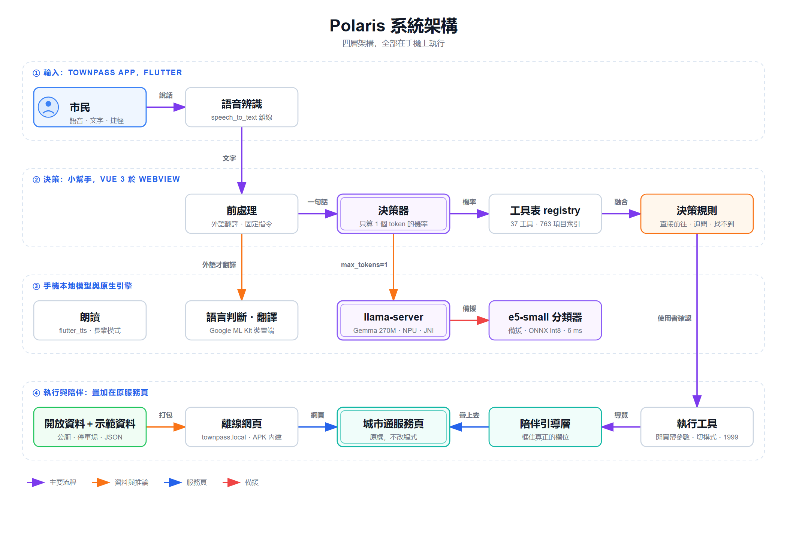</p>

---

## 一、一般參賽者必填項目

### 1. 專案簡介 / Project Overview

#### 專案目的與想解決的問題

臺北通的服務很多，入口分散在不同分類。長輩、兒童、數位能力較弱或不熟悉中文的市民，常遇到兩個困難：不知道該用哪一項服務，以及進了服務頁也不知道怎麼填。如果改用雲端語言模型協助，又會帶來連網、個資外送與答非所問的問題。

本專案在臺北通上加入一個獨立的微服務與一層引導，既有服務的程式不需要修改：

1. 使用者用語音或文字說明需求。
2. 手機上的小模型從服務清單中選出一項，不生成文字。信心不足時列出候選，讓使用者點選。
3. 進入服務頁後，引導層標示該操作的欄位與按鈕，並說明這一步要做什麼，由使用者自己操作。付款與送出一律由本人按下。

#### 核心功能摘要

- 語意導航涵蓋 37 項服務與功能，支援中文、英文、越南語、印尼語與泰語，手機 NPU 上單次判斷約 60 毫秒。
- 31 份導覽腳本搭配三層定位機制，其中 15 條服務流程已在實機上完成端到端驗證。
- 網頁、模型與推論伺服器全部打包進 APK，可離線使用，並提供兒童、一般、長輩三種介面。

#### Demo 截圖

| 小幫手入口 | 主畫面 | 繳水費引導 | 引導收合 |
|---|---|---|---|
| 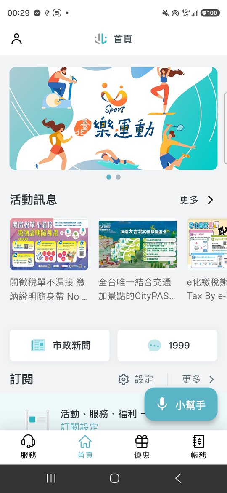 | 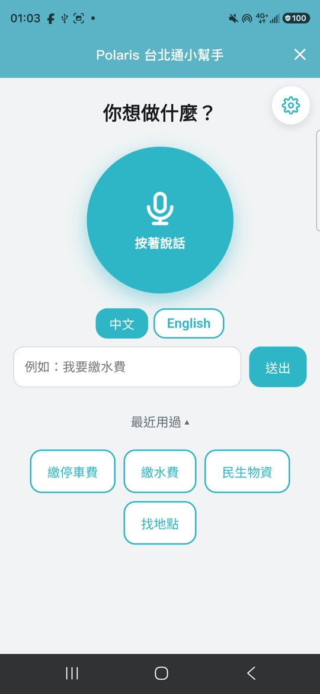 |  | 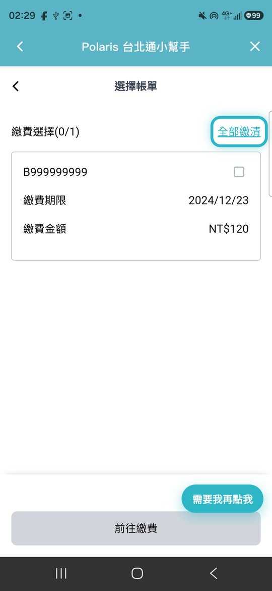 |
| **找地點：選擇公廁** | **找地點：地圖標記** | **長輩模式** | **英文輸入** |
|  | 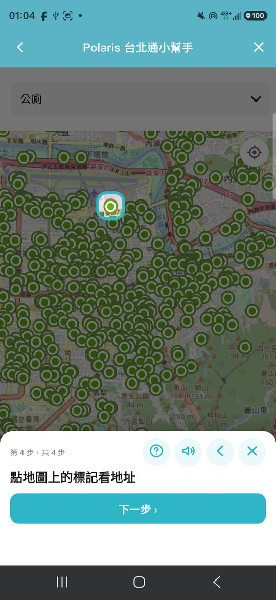 | 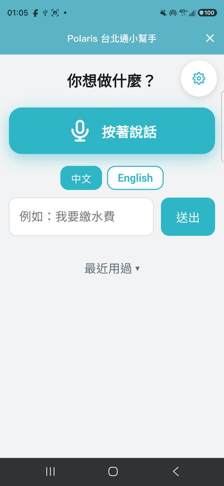 |  |
| **介面模式設定** | **找不到時重新詢問** | **連續誤觸時主動協助** | **開發者儀表板** |
| 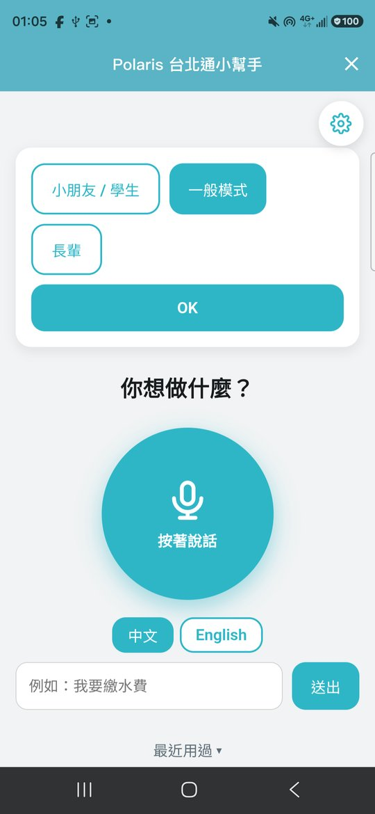 | 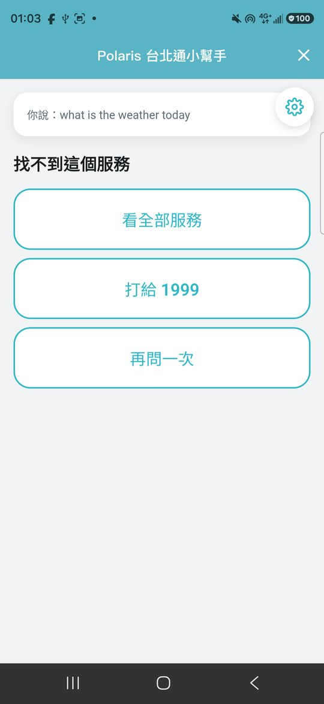 | 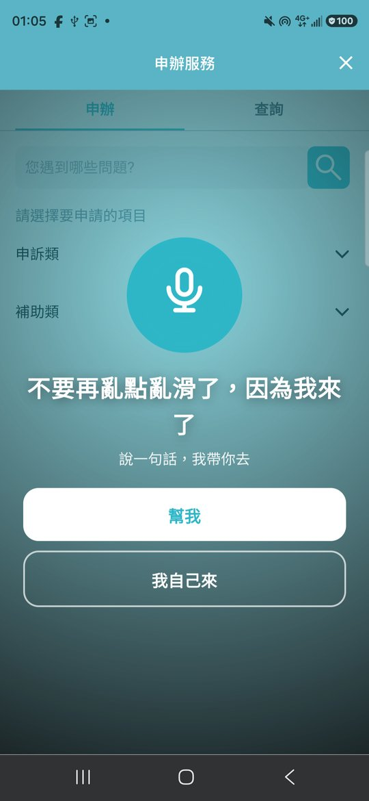 | 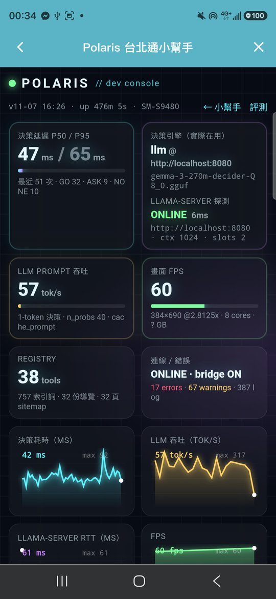 |

#### Demo GIF

實機逐步錄製，每個操作一格。

| 繳水費 | 找公廁 | 長輩模式繳停車費 | 陳情 |
|---|---|---|---|
|  |  | 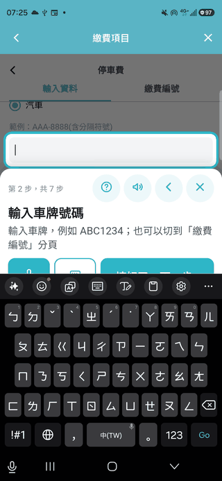 | 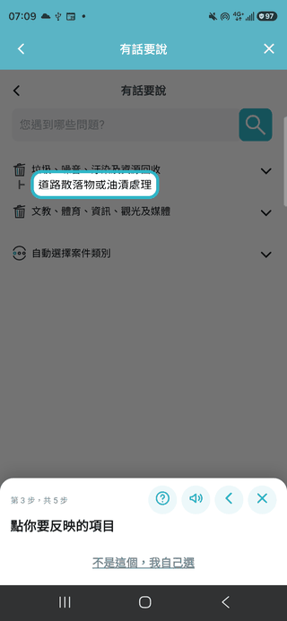 |
| 水號、查詢、選帳單、付款方式、完成 | 自動選定公廁，地圖顯示標記 | 每一步朗讀，付款前再確認一次 | 選類別，逐欄填寫，案件受理 |

15 條流程共 188 張實機截圖放在 Release 附件 `walkthrough-screenshots.zip`。

---

### 2. 系統架構 / System Architecture

#### 架構圖


系統分四層，全部在手機上執行：

1. **輸入**：TownPass App 以 Flutter 處理語音辨識，網頁只接收文字。
2. **決策**：小幫手是在 WebView 中執行的 Vue 3 網頁。它把句子交給決策器，取得每個工具代號的機率，再依工具表與固定規則決定下一步。
3. **本地模型與原生引擎**：llama-server 在 App 程序內執行 Gemma 決策器，優先使用 Hexagon NPU。ML Kit 負責語言判斷與翻譯，flutter_tts 負責朗讀。
4. **執行與陪伴**：工具表定義每個工具要開啟的頁面與參數。引導層由 App 注入到每個服務頁，服務程式不需修改。

四張技術圖的原始檔與產生方式見 [docs/diagrams/](docs/diagrams/)。

#### 決策流程

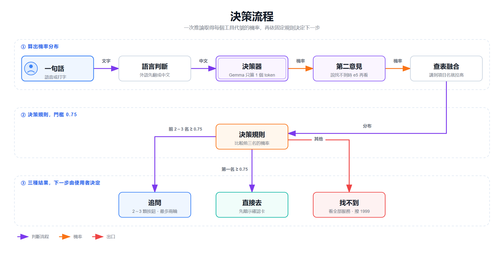

- **單一 token 決策**：prompt 前段是固定的工具清單，每個工具對應一個字母代號，最後接上使用者的句子。llama-server 以 `max_tokens=1` 回傳候選字母的 logprob，換算成機率分布。模型不產生文字，輸出只可能是清單內的工具。
- **固定前綴快取**：工具清單每次相同，KV cache 計算一次後重複使用，之後每句只需處理十幾個 token。在 Galaxy S26 Ultra 上，未快取時 NPU 需 94 毫秒、CPU 需 318 毫秒，快取後兩者都在 20 毫秒以內，端到端判斷的中位數為 63 毫秒。
- **第二意見**：Gemma 判斷為範圍外，但句子含有明確的服務詞時，改由 e5 分類器再判斷一次。e5 的結果落在相符服務、且機率達 0.8 以上，才顯示確認卡。
- **查表融合**：工具表收錄 763 個項目名稱與別名。句子提到具體項目時，提高對應工具的機率；一個詞對應多個工具時，只提高這幾個，使系統改為追問。
- **決策規則**：第一名機率達 0.75 時直接前往，但仍先顯示確認卡；前兩到三名合計達 0.75 時以按鈕追問；其餘情況回報找不到，並提供全部服務列表與撥打 1999。使用者否定某個選項時，只將其機率歸零重排，不重跑模型，最多追問兩輪。
- **參數處理**：水號、車牌、地點項目等參數只從原句抽取，帶入服務頁後由使用者確認，系統不補值。

#### 陪伴引導


- **疊加方式**：App 只注入一支載入器，由它載入 `guide-overlay.js`，被引導的服務頁維持原本的程式。
- **三層定位**：
  1. 導覽腳本：31 份，依畫面文字、標籤與元素角色定位。
  2. 網站地圖：爬取 31 頁，以 BFS 找出到達目標頁需要先點哪些元素。
  3. 版面打分：即時掃描當頁可互動元素並評分，有模型時由 Gemma 從候選中選一個。
  4. 三層都找不到時只顯示文字說明，不標示任何位置。
- **引導內容**：標示真正的欄位或按鈕並調暗其他區域，用一句話說明步驟。欄位可以用說的填，系統以規則抽出數字後填入。遇到彈出視窗時面板自動縮小；送出被頁面退回時，回頭標示出錯的欄位。
- **引導強度**：使用者連續兩步自行完成後，面板縮成角落的小圓鈕；停滯 45 秒或點擊小圓鈕時恢復。不在導覽中時，6 秒內連續點擊 5 次會觸發主動協助。付款與送出只標示、不代按，使用者可隨時結束引導。
- **介面模式**：長輩模式放大字體、每步朗讀、送出前多確認一次；兒童模式用口語說明，付款前提示請大人確認。

#### 訓練管線


- **訓練資料**：約 6,300 句服務語句，來源有兩種：手寫核心說法經模板擴增口語、語音辨識錯字、中英夾雜與外語變化，以及從服務頁 mock 資料與頁面文字自動擷取的句子。另有 965 題按鈕選擇題，由網站地圖產生，每題的選項順序都打亂，讓模型依標籤內容判斷而非記憶位置。
- **Gemma 3 270M**：凍結底座，只訓練 LoRA，rank 16，套用於 attention 與 MLP 的全部投影層。loss 只計算答案字母所在的最後一個位置。訓練與推論使用同一份 prompt，程式會核對兩者完全一致。合併後量化為 GGUF Q8_0，大小 292 MB。
- **e5-small 分類器**：以同一批句子微調分類頭，詞表從約 25 萬裁到約 1.3 萬，量化為 ONNX int8，大小 27.5 MB，在 WebView 中以 Transformers.js 執行。
- **微調的效果**：零樣本的 Gemma 270M 與 1B 在早期 107 句測試集上第一輪命中僅 0% 到 6%，零樣本 e5 在 1,027 句測試集上約 50%；微調後兩者第一輪皆超過 93%。

#### 使用到的主要技術堆疊（Tech Stack）

| 類別 | 使用技術 / 版本 | 備註 |
|---|---|---|
| 前端框架 | Vue 3.4、Vite 5、TypeScript 5.4；服務頁另用 Tailwind CSS 3.4、Pinia、Leaflet 1.9 | `assistant/` 為小幫手與引導層，`TownPass-Services/` 為服務頁 |
| App | Flutter 3.47.6、flutter_inappwebview 6.1 | 以 TownPass 開源 App 為基礎，WebView 載入 APK 內建網頁 |
| 後端框架 | 無傳統後端；手機上的 llama.cpp b12180 `llama-server`，Snapdragon Hexagon NPU 版 | 在 App 程序內以 JNI 啟動，只提供本機推論 |
| 資料庫 | 無；設定存於 WebView 的 localStorage 與 sessionStorage，服務資料為 JSON | 使用者資料不離開手機 |
| AI 模型 | Gemma 3 270M 以 LoRA 微調後轉 GGUF Q8_0；multilingual-e5-small 微調後轉 ONNX int8 | 訓練使用 PyTorch、Transformers、PEFT |
| 裝置端能力 | speech_to_text 7.5、Google ML Kit Language ID 與 Translation、flutter_tts | 語音、翻譯、朗讀皆使用手機本身的引擎 |
| 外部 API | 執行時不呼叫任何 API；地圖底圖使用 OpenStreetMap 圖磚，需要網路 | 公廁與停車場為政府開放資料，見功能說明 |

---

### 3. 安裝與執行方式 / Installation & Run

#### 方式 A：直接安裝

1. 從本 repo 的 Releases 下載 `Polaris-offline.apk`。
2. 在 Android 手機上安裝，需允許安裝不明來源的應用程式。
3. 開啟 TownPass，從首頁或服務列表進入小幫手。麥克風權限請選擇使用 App 時允許。

手機需求與設定：

- 決策器需要 arm64 Android。Snapdragon 的 Hexagon NPU 最快，實測機型為 Galaxy S26 Ultra；沒有 NPU 時改用 CPU，或自動改用 e5 分類器。
- 離線語音：在 Google App 的 Settings、Voice、Offline speech recognition 下載中文台灣與 English (US)。
- 外語翻譯：越南語、印尼語、泰語的翻譯模型在第一次翻譯時自動下載，每個約 30 MB，之後可離線使用。

#### 方式 B：在電腦瀏覽器執行網頁版

執行本專案前，請確認環境已安裝以下組件：

- **Node.js**：v20.17 以上，搭配 pnpm 9
- **Python**：v3.12 以上，只有重建資料或重新訓練時需要
- **選用**：llama.cpp b12180 的 `llama-server`，要在電腦上執行 Gemma 決策器時需要

步驟說明：

1. 複製專案庫：`git clone https://github.com/taipei-doit/townpass2026-PopPal.git`
2. 進入專案目錄：`cd townpass2026-PopPal`
3. 安裝依賴套件並建置：
   ```bash
   cd TownPass-Services && pnpm install && pnpm build-only && cd ..
   cd assistant && pnpm install && pnpm build-only && cd ..
   ```
4. 設定環境變數，見下一節；全部可以使用預設值。
5. 啟動服務：
   ```bash
   node scripts/serve-local.mjs --port 5180
   ```
   開啟 <http://localhost:5180/assistant/>。沒有 llama-server 時，小幫手自動改用 WebView 內的 e5 分類器。要使用 Gemma 決策器，先把 Release 的 `gemma-3-270m-decider-Q8_0.gguf` 放到 `tools/llm/out/`，再執行：
   ```bash
   llama-server -m tools/llm/out/gemma-3-270m-decider-Q8_0.gguf --port 8080 -c 4096 --cache-reuse 256
   node scripts/serve-local.mjs --port 5180 --llm http://127.0.0.1:8080
   ```

#### 方式 C：自行編譯離線版 APK

另需 Flutter 3.47.6、JDK 17、Android SDK，以及 llama.cpp 官方的 `llama-b12180-bin-android-arm64-snapdragon.tar.gz`，解壓到 `tools/llama-android/snapdragon/`。

```powershell
.\scripts\build-release.ps1
```

輸出在 `release\`。資料重建、模型重訓與遷移的完整步驟見 [docs/MAINTENANCE.md](docs/MAINTENANCE.md)。

#### 需要設定的環境參數（.env example）

網頁建置參數：複製 [`assistant/.env.example`](assistant/.env.example) 為 `assistant/.env`。

```dotenv
# 服務頁的網址前綴；留空表示與小幫手同網域
VITE_SERVICES_BASE=
```

App 建置參數使用 Flutter 的 `--dart-define`：

| 參數 | 預設 | 說明 |
|---|---|---|
| `OFFLINE_WEB` | `false` | 設為 `true` 時使用 APK 內建網頁 `http://townpass.local/`，可離線使用 |
| `LLM_URL` | 空 | 決策器網址；離線版設為 `http://localhost:8080`，即 App 內的 llama-server |
| `DEV_SERVICE_URL` | 內建網頁 | 開發時指向電腦，例如 `http://<電腦IP>:5180/` |
| `ASSISTANT_URL` | 空 | 小幫手網址，預設為服務頁同網域的 `/assistant/` |

#### Docker 執行方式

```bash
# 先把 Release 的 gemma-3-270m-decider-Q8_0.gguf 放到 tools/llm/out/
docker compose -f deploy/docker-compose.yml up -d --build
# 小幫手：http://localhost:18080/assistant/　服務頁：http://localhost:18080/
```

nginx 容器提供服務頁與小幫手，並將 `/llm/` 轉發到 llama.cpp 容器，設定在 [deploy/](deploy/)。

---

### 4. 功能說明 / Features

| 功能編號 | 功能名稱 | 簡述 | 資料來源描述 |
|---|---|---|---|
| 4.1 | 語意導航 | 以語音、文字或常用捷徑描述需求，決策器從 37 項服務與功能中選出一項，顯示確認卡後前往 | 無，為內部計算產生；服務目錄整理自 TownPass App 服務清單與服務頁 |
| 4.2 | 追問與出口 | 依機率決定直接前往、以 2 到 3 個按鈕追問或回報找不到；否定選項後立即重排，最多兩輪，最後可查看全部服務或撥打 1999 | 無，為內部計算產生 |
| 4.3 | 參數帶入 | 句子含具體項目或號碼時，直接開啟對應頁面並預填，由使用者確認 | 無；項目索引由服務頁 mock 資料自動產生 |
| 4.4 | 陪伴引導 | 疊加在原服務頁上，標示要點擊或填寫的欄位並說明步驟；31 份導覽腳本，15 條流程已完成實機驗證 | 無；導覽腳本與自動爬取的網站地圖 |
| 4.5 | 語音填欄位 | 在欄位步驟說出內容，以規則抽出後填入並請使用者確認 | 無，為內部計算產生 |
| 4.6 | 引導強度調整 | 連續兩步自行完成後收合為小圓鈕，停滯 45 秒或點擊時恢復；連續誤觸時主動協助 | 無 |
| 4.7 | 介面模式 | 兒童、一般、長輩三種模式，長輩模式放大字體、每步朗讀、送出前再確認 | 無 |
| 4.8 | 多語輸入 | 介面支援中英文；越南語、印尼語、泰語經手機本地翻譯後判斷 | 無；Google ML Kit 裝置端翻譯模型 |
| 4.9 | 繳費服務 | 水費、停車費、地方稅、學雜費、聯醫醫療費、其他費用與繳費紀錄，從查詢引導到付款完成 | TownPass-Services 範例的示範資料，JSON 格式 |
| 4.10 | 找地點 | 9 類 46 項，包括公廁、停車場、充電站、飲水機，以地圖顯示標記 | 公廁：臺北市政府環境保護局 臺北市公廁點位資訊，政府資料開放平臺 <https://data.gov.tw/dataset/138798>，CSV，不定期更新；停車場：臺北市停車管理工程處 臺北市停車場資訊 TCMSV <https://data.gov.tw/dataset/128435>；底圖：OpenStreetMap；其餘項目為示範資料 |
| 4.11 | 補齊示範服務 | 原 App 只有入口的 13 項服務補上可操作的示範頁，例如疫苗預約、聯醫掛號、親子館、網路投票、意見調查、里辦服務、愛遊動物園 | 示範資料，介面依原 App 設計 |
| 4.12 | 離線執行 | 網頁、模型與 llama-server 都在 APK 內，飛航模式下仍可使用導航與引導 | 無 |

#### 決策器準確度

測試集共 1,027 句，涵蓋口語、語音辨識錯字、英文、外語、長句、近似混淆、中英夾雜與 128 句範圍外語句，並已與訓練句去重。完整結果見 [eval/MATRIX_1K.md](eval/MATRIX_1K.md) 與 [eval/PHONE.md](eval/PHONE.md)。

| 引擎 | 執行位置 | 第一輪命中 | 兩輪內命中 | 範圍外辨識 | 延遲中位數 |
|---|---|---|---|---|---|
| Gemma 3 270M 決策器，微調 | Galaxy S26 Ultra NPU，App 內 | 93.2% | 97.3% | 99.2% | 63 ms |
| e5-small 分類器，微調，備援 | WebView，ONNX | 94.9% | 96.8% | 90.6% | 6 ms |
| 對照：e5-small 零樣本 | WebView | 50.4% | 63.7% | 49.2% | 6 ms |

依句型分列的第一輪命中率：

| 句型 | 口語 | 關鍵字 | 長句 | 語音錯字 | 中英夾雜 | 英文 | 近似混淆 | 帶參數 | 外語 | 範圍外辨識 |
|---|---|---|---|---|---|---|---|---|---|---|
| Gemma，手機 NPU | 91.5% | 98.2% | 90.1% | 88.7% | 96.0% | 95.6% | 98.6% | 97.1% | 92.8% | 99.2% |
| e5 分類器 | 94.1% | 98.2% | 89.2% | 93.0% | 100.0% | 96.3% | 97.3% | 100.0% | 94.6% | 90.6% |

語音辨識錯字與長句的命中率最低。整體兩輪內命中率比第一輪高約 4 個百分點，這段差距由追問補回。

測試集由 AI 依功能、情境、句子三層產生，並非真實使用者語料，數字可能偏高。決策器判斷錯誤時，由確認卡、追問與 1999 出口承接，不會替使用者送出任何資料。

---

## 二、AI 使用聲明 / AI Usage Declaration

### 1. 使用到的 AI 模型

- **Claude**：Claude Code，模型為 Claude Opus 5.5，作為主要開發助理；Claude Sonnet 子代理用於產生測試語句〔請確認：開發期間用到的其他 Claude 版本〕
- **ChatGPT**：〔請填寫：未使用／使用版本〕
- **Gemini**：〔請填寫：未使用／使用版本〕
- **影像生成**：〔請填寫：未使用／使用工具〕
- **自行架設 / 本地模型，產品本身使用**：
  - Google Gemma 3 270M，`google/gemma-3-270m-it`，本團隊以 LoRA 微調為服務決策器，格式 GGUF Q8_0
  - Microsoft multilingual-e5-small，`intfloat/multilingual-e5-small`，本團隊微調為服務分類器，格式 ONNX int8

### 2. 使用範圍

- **程式碼產生**：小幫手前端、陪伴引導層、Flutter 原生橋接、App 內推論服務、訓練與評測腳本，大部分在 Claude Code 協助下完成，約佔總程式碼的〔請填寫比例〕。
- **UI/UX 設計協助**：陪伴模式的互動規則由團隊提出並在實機上反覆修正，AI 協助實作與版面調整。
- **文字生成**：README、規格書 `SPEC.md`、開發文件，以及五種語言介面文案的初稿與潤飾。
- **測試案例 / 文件生成**：1,027 句決策器測試集、評測矩陣腳本、網站遞迴稽核與實機自動操作腳本。
- **資料清洗或摘要**：從服務頁 mock 資料擷取訓練句與項目索引，以及 13 項示範服務與找地點示範地點的資料產生腳本。

### 3. AI 產生內容如何被驗證或修改

- **實機驗證**：每一輪修改都在 Galaxy S26 Ultra 上實測；15 條服務流程由自動操作腳本在實機上逐步執行並截圖。
- **量化評測**：決策器以 1,027 句測試集評估第一輪命中、兩輪內命中、範圍外辨識與延遲，並交叉比對手機與電腦的結果。
- **網站稽核**：遞迴走訪 174 個服務頁，0 缺檔、0 例外，結果見 [eval/AUDIT.md](eval/AUDIT.md)。
- **結構性防護**：模型只能從服務清單選出一個代號，不產生文字；參數只從原句抽取並由使用者確認；付款與送出一律由使用者本人按下。
- **人工 Code Review**：〔請填寫：審查方式與人數〕

### 4. 與 AI 相關的限制或風險

- **決策錯誤**：微調模型在測試集上第一輪命中約 93% 到 95%，仍會出錯；系統以確認卡、追問與 1999 出口承接，不會自動送出。
- **測試集來源**：測試集由 AI 產生，並非真實市民語料，實際表現需以真實場域收集的語句再驗證。
- **自由格式參數**：車牌、身分證、案件編號、地址等欄位的抽取規則尚不完整，由使用者自行輸入。
- **示範資料**：除公廁與停車場外，服務資料為示範用途，並非真實市政資料。
- **敏感資料**：開發過程中〔請確認〕未曾輸入任何專案機密、使用者個人資料或未公開的 API 金鑰；產品本身不需要任何金鑰，執行時不將使用者資料傳出手機。

---

## 三、技術轉移

### 併入臺北通 App 的整合點

| 項目 | 位置 | 說明 |
|---|---|---|
| 小幫手入口 | `TownPass/lib/page/city_service/model/my_service_model.dart` | 服務列表中的一個項目，開啟 `/assistant/` |
| 引導層注入 | `TownPass/lib/service/assistant_service.dart`、`TownPass/lib/util/tp_web_view.dart` | 以 `initialUserScripts` 注入載入器，再由載入器載入 `guide-overlay.js` |
| 原生橋接 | `TownPass/lib/util/web_message_handler/tp_assistant_message_handler.dart` | `stt`、`lang_id`、`translate`、`translate_prepare`、`tts` 五個訊息 |
| 本機推論 | `TownPass/lib/service/llm_server_service.dart`、`TownPass/android/app/src/main/kotlin/com/example/townpass/MainActivity.kt`、`tools/llama-android/stub/` | App 啟動時在程序內啟動 llama-server，NPU 無法使用時改用 CPU，每 20 秒健康檢查 |
| 離線網頁 | `TownPass/lib/service/offline_web_service.dart` | 將 `http://townpass.local/*` 對應到 APK 內建網頁；正式上線若改由伺服器提供網頁，可不啟用 |
| 小幫手與引導層 | `assistant/` | 網頁本體，與服務頁同網域部署即可 |

### 需要持續維護的資料

| 資料 | 位置 | 何時更新 |
|---|---|---|
| 服務目錄 | `assistant/public/data/catalog.json` | 新增或調整服務 |
| 工具表 | `assistant/public/data/registry.json` | 由腳本產生，服務目錄或 mock 資料變動後重建 |
| 導覽腳本 | `assistant/public/guides/` | 服務頁流程變動 |
| 網站地圖 | `assistant/public/data/sitemap.json` | 服務頁版面變動後重爬 |
| 訓練資料 | `tools/tinycls/data/`、`tools/llm/ui_pick.jsonl` | 服務目錄變動後重建並重訓 |

更新順序、重訓指令、評測方式與遷移到新環境的步驟，都寫在 [docs/MAINTENANCE.md](docs/MAINTENANCE.md)。

移植到其他 Android 機型、iPhone 或網頁版的步驟與驗證方式，寫在 [docs/PORTING.md](docs/PORTING.md)。

---

## 授權

本專案以 [GPL-3.0](LICENSE) 釋出，沿用 TownPass App 的授權。模型權重、政府開放資料與第三方元件的來源與授權見 [THIRD_PARTY_NOTICES.md](THIRD_PARTY_NOTICES.md)；Gemma 衍生權重受 [Gemma Terms of Use](https://ai.google.dev/gemma/terms) 約束。
